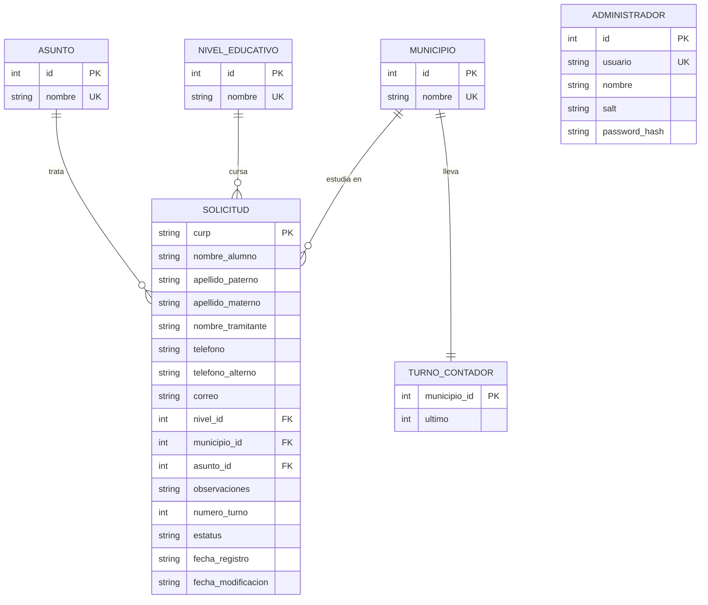
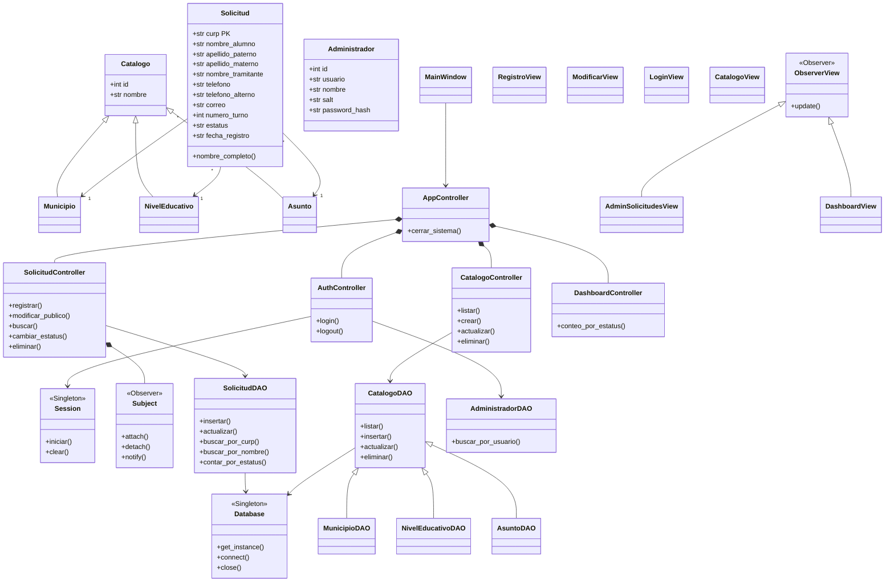

# Ticket de Turno

Sistema de escritorio para que padres de familia agenden citas de trámites
escolares de sus hijos. Los administradores consultan, modifican y resuelven
las solicitudes y ven un dashboard.

## Ejecutar
```bash
python main.py            
pip install reportlab     
```
En Linux, si falta tkinter: `sudo apt install python3-tk`.

**Administrador inicial:** usuario `admin` · contraseña `Admin123`
(se crea solo la primera vez; la contraseña se guarda con PBKDF2 + sal).


# Modelo Base de datos



# Modelo de clases


Validación: `CurpValidator`, `SolicitudValidator`. Seguridad: `PasswordHasher`.
Comprobante: `ComprobanteService`.

